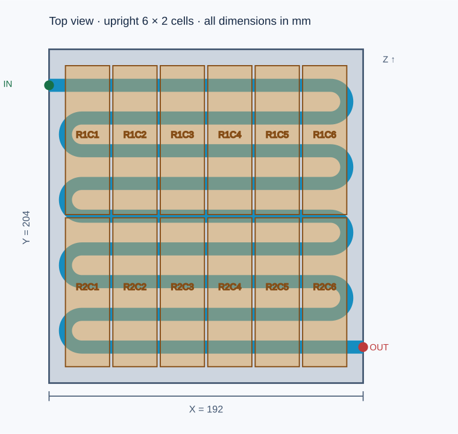
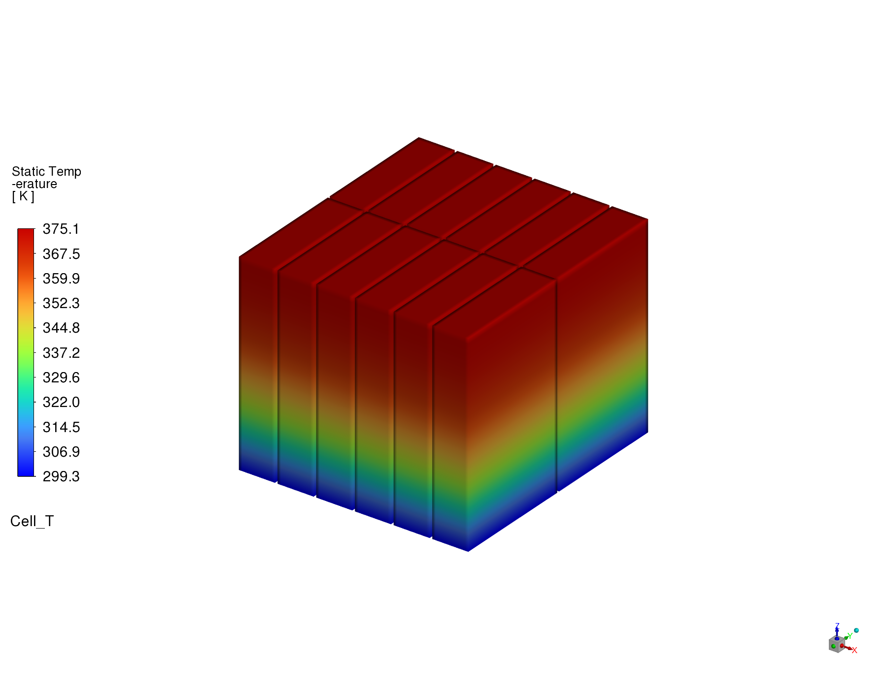

# Battery Liquid Cooling Plate Thermal Management

A three-dimensional conjugate heat transfer (CHT) study of a bottom-cooled module of 12 upright prismatic lithium-ion cells. The study uses Ansys Fluent 2026 R1 to examine how heat generation and water flow affect cell temperature, coolant temperature rise and cold-plate pressure drop. The results are from CFD. Experimental validation and geometry optimization remain open.

At the baseline of **20 W per cell and 0.06 kg/s**, the fine mesh predicted **101.906 °C** maximum cell temperature, **75.542 K** module-wide temperature spread and **25.9566 °C** mass-weighted coolant outlet temperature. Four temperature metrics met the prescribed medium-to-fine difference limits. The pressure drop changed by **8.21%**, exceeding its **2%** limit.

## Geometry and boundary conditions



Two rows of six cells sit on a **192 × 204 × 10 mm** aluminum cold plate. Each upright cell measures **27 × 91 × 148 mm** (X × Y × Z), with a **2 mm** gap in each array direction. The **8 × 4 mm** closed rectangular channel has nine straight legs at **20 mm** pitch and eight 180° bends with **10 mm** centerline radius. Its centerline length is about **1.659 m**. The model has one connected water body and 14 solid bodies, comprising the 12 cells, base and lid.

| Boundary or source | Baseline setting |
| --- | --- |
| Water inlet | 0.06 kg/s, 298.15 K, 5% turbulence intensity, 5.333 mm hydraulic diameter |
| Water outlet | 0 Pa gauge, 298.15 K backflow temperature |
| Internal interfaces | Stationary no-slip water walls, thermally coupled interfaces, ideal cell-to-plate contact |
| External walls | Adiabatic |
| Cell heating | 20 W/cell, 240 W total, 55,000.055 W/m³ in each cell |

## Numerical method

Fluent used a steady, three-dimensional, double-precision pressure-based solver with the energy equation and k–ω SST turbulence model. Water properties were constant and the cell solids used an isotropic effective conductivity. Hybrid initialization and 50 first-order iterations preceded second-order discretization with SIMPLE coupling and local pseudo-time for convergence. The acceptance checks combined scaled residuals (≤10⁻⁴ for flow and turbulence, ≤10⁻⁷ for energy), mass imbalance (≤0.2%), energy imbalance (≤1%), and checkpoint changes in maximum temperature (≤0.1 K) and pressure drop (≤1%). See the [model notes](docs/model.md) and [baseline configuration](config/baseline.json).

## Mesh sensitivity

The coarse, medium and fine cases used the same physics and met the source project's iteration and balance checks.

| Mesh | Total cells | Min. orthogonal quality | Tmax (°C) | Tmin (°C) | ΔT (K) | Outlet (°C) | Δp (kPa) |
| --- | ---: | ---: | ---: | ---: | ---: | ---: | ---: |
| Coarse | 701,908 | 0.02711 | 101.930 | 26.738 | 75.191 | 25.95661 | 23.251 |
| Medium | 1,436,439 | 0.05355 | 101.901 | 26.536 | 75.364 | 25.95658 | 24.310 |
| Fine | 2,902,379 | 0.05888 | 101.906 | 26.364 | 75.542 | 25.95660 | 22.464 |

The medium-to-fine differences are 0.0050 K for Tmax, 0.1725 K for Tmin, 0.1775 K for ΔT and 0.000016 K for outlet temperature. The module temperature spread continued to increase with refinement, and pressure drop varied nonmonotonically. All three meshes fell below the project's 0.1 minimum orthogonal quality target. Overall mesh independence was not established and no Grid Convergence Index was calculated. [Comparison plot](assets/mesh-comparison.png) · [Full-precision data](data/step12_mesh_comparison.csv)

## Parameter study

Five of eight fine-mesh cases passed the study checks. Both 0.02 kg/s runs (laminar and SST) and the 0.04 kg/s SST run failed convergence checks and were excluded from the trend comparisons. The 0.06 kg/s, 20 W/cell point reuses the fine-mesh baseline.

| Flow (kg/s) | Heat (W/cell) | Tmax (°C) | ΔT (K) | Outlet (°C) | Δp (kPa) |
| ---: | ---: | ---: | ---: | ---: |
| 0.06 | 10 | 63.449 | 37.767 | 25.4783 | 23.481 |
| 0.06 | 20 | 101.906 | 75.542 | 25.9566 | 22.464 |
| 0.06 | 30 | 140.347 | 113.300 | 26.4349 | 23.481 |
| 0.08 | 20 | 101.564 | 75.339 | 25.7175 | 38.183 |
| 0.10 | 20 | 101.357 | 75.218 | 25.5740 | 55.875 |

At 20 W/cell, raising flow from 0.06 to 0.10 kg/s lowered Tmax by about **0.549 K**. At 0.06 kg/s, raising heat from 10 to 30 W/cell increased Tmax by about **76.90 K**. Pressure results remain exploratory. At fixed flow, the 10 and 30 W/cell cases differ from the 20 W/cell baseline by **4.52%** in pressure drop despite constant water properties and no buoyancy. Δp is the difference between area-weighted inlet and outlet static pressures. The CSV hydraulic power is Δp × mass flow / density. [Results](data/step14_study_results.csv) · [Case dispositions](data/step14_case_status.csv)



*Medium-mesh baseline after 551 iterations. The difference between the highest and lowest cell-average temperatures was 0.624 K, while the global difference between local cell extrema was 75.364 K.*

## Reproduce the numerical summaries

Run from the repository root with Python 3.10 or newer. The standard library is sufficient.

```sh
python scripts/analyze_results.py
```

The script recomputes the mesh checks from the comparison CSV, checks the accepted cases against the complete study manifest and evaluates outlet temperature rise from the exported scalar data. The [Ansys workflow](docs/workflow.md) explains how the project journals were used and what inputs a new solve requires.

| Directory | Contents |
| --- | --- |
| `ansys/` | Selected SpaceClaim, Workbench/Meshing and Fluent scripts and journals |
| `config/` | Baseline settings and eight-case study manifest |
| `data/` | Original mesh, cell and study summary exports |
| `assets/` | Geometry schematic and selected project figures |
| `docs/` | Model details, workflow and source mapping |
| `scripts/` | Portable result analysis |

## Attribution and rights

The source project does not provide a verified public author attribution or a redistribution license. See [source mapping](docs/provenance.md) for the origin of the data, scripts and figures.

